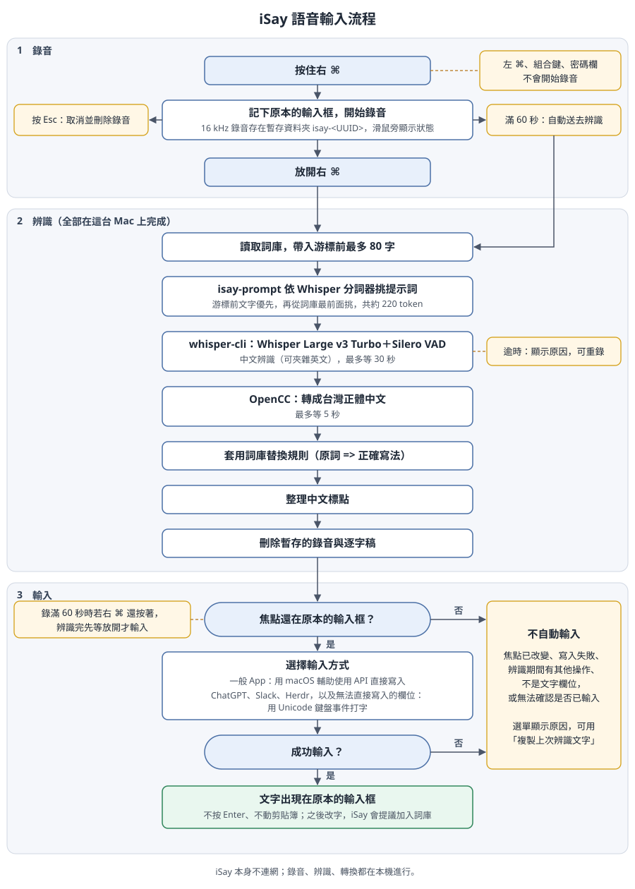

# iSay

macOS 選單列語音輸入。像拿對講機一樣：**按住右 ⌘，看到麥克風圖示變實心就說話，放開後貼上文字。** 支援同一句話中英夾雜，例如「請把這個檔案上傳到 Cloud Run」。中文會轉成台灣常用的正體中文，音訊在 Mac 上辨識，不上傳。



## 安裝

需要 macOS 14 以上、[Homebrew](https://brew.sh/) 和 Xcode Command Line Tools（可用 `xcode-select --install` 安裝）。在專案目錄執行：

```sh
git clone https://github.com/youchenlee/isay.git
cd isay
./setup.sh
open ~/Applications/iSay.app
```

第一次安裝會下載約 575 MB 的語音模型。點選單列的麥克風，選「設定權限…」並允許麥克風，再選一次以開啟輔助使用設定。若清單上沒有 iSay，用「＋」加入 `~/Applications/iSay.app`。若 iSay 提示需要「輸入監控」，在系統設定開啟後重新啟動 iSay。

更新已安裝的 iSay 時，先從選單列選「結束 iSay」，更新專案後再跑 `./setup.sh`。詞庫會保留。

想讓 iSay 開機後自動執行，在選單勾選「登入時啟動」。若 macOS 要求確認，會打開系統設定的「登入項目」頁面。

如果鑰匙圈只有一張有效的 Apple Development 開發者憑證，安裝程式會用它簽署 iSay；也可用 `ISAY_SIGNING_IDENTITY` 指定簽署身分。有用憑證簽署的舊版時，新版必須符合舊版的簽署要求才會覆蓋。從臨時簽署換成憑證簽署後，第一次仍可能要重新授權；之後用相同身分更新，macOS 才能沿用授權。

選好要輸入的地方，再按住右 ⌘。左 ⌘ 不會啟動錄音；右 ⌘ 搭其他按鍵仍可當原本的快捷鍵，當次錄音會取消。iSay 通常直接寫入原輸入框。ChatGPT、Slack 桌面版及不支援直接寫入的欄位，會在焦點仍相同、辨識期間沒有操作鍵盤或滑鼠時，用鍵盤事件輸入文字。不動剪貼簿、不按 Enter。如果未能自動輸入，選單會顯示原因，也可選「複製上次辨識文字」。

按住右 ⌘ 錄音時可按 Esc 取消，這段不會送去辨識。錄滿 60 秒會自動辨識已錄到的內容；若需透過鍵盤事件輸入，會等你放開右 ⌘。語音辨識最多等 30 秒，正體中文轉換最多等 5 秒；辨識逾時後可重新錄音。

錄音時，滑鼠旁會顯示正在錄音、辨識或輸入結果。提示不會搶走輸入焦點；如果輸入失敗，可在 iSay 選單查看原因。

## 權限與隱私

iSay 需要三項 macOS 權限：

| 權限 | 用途 |
|---|---|
| 麥克風 | 按住右 ⌘ 時錄音。 |
| 輔助使用 | 確認原輸入框是否仍在焦點上，並把辨識結果寫入輸入框；部分 App 需要用鍵盤事件替你打字。也用來讀取游標前的文字，以及讀回剛輸入的那段文字（見下方說明）。 |
| 輸入監控 | 判斷右 ⌘ 何時按下、放開，以及是否和其他按鍵一起按。 |

取得輸入監控權限後，iSay 會收到你在這台 Mac 上的**所有**按鍵按下與放開事件。它只在記憶體暫存目前按著的鍵碼，用來分辨右 ⌘ 是單獨按下還是快捷鍵的一部分；放開就移除，不保存打字內容，也不寫入檔案或上傳。

辨識在本機完成；iSay App 本身不連網。處理期間，錄音檔和逐字稿（Whisper 原始輸出與轉成正體中文後的版本）會寫入系統暫存資料夾裡的 `isay-<UUID>` 資料夾，辨識結束或取消後刪除。iSay 被強制結束、當機，或刪除失敗時，這些檔案可能暫時留下；下次啟動 iSay 時會清掉這類資料夾裡的錄音和逐字稿，其他檔案不動。選單中的「複製上次辨識文字」只把最後一次結果留在記憶體；只有你選這個項目時，iSay 才會寫入剪貼簿。詞庫存在 `~/.config/isay/詞庫.txt`，不在這個 repo 裡。辨識時，詞庫裡的提示詞會以參數傳給本機的 `whisper-cli`、以標準輸入傳給 iSay 內附的 `isay-prompt`，同一個 macOS 帳號下的其他程式可在辨識期間看到參數內容，所以不要把密碼等機密寫進詞庫。

**游標前文字**：按下右 ⌘ 時，iSay 會讀取輸入框裡游標前最多 80 個字，和詞庫一起交給 Whisper 參考，讓人名、術語更容易拼對。這段文字和詞庫一樣，會以參數傳給 `whisper-cli`、以標準輸入傳給 `isay-prompt`，只用於這一次辨識，不寫入檔案也不保存。密碼欄不讀；不想讓 iSay 讀取草稿，可在選單取消勾選「參考游標前文字」。

**從修正學新詞**：自動輸入後 60 秒內，iSay 每 2 秒讀回剛輸入的那段文字（加上後面最多 24 個字）。如果你改掉其中一段，iSay 會整理出「原詞 => 正確寫法」，在滑鼠旁和選單提示；只有你在選單點「加入詞庫」，才會寫進詞庫。讀回的文字只在記憶體比對，不保存。

`setup.sh` 會透過 Homebrew 安裝 `whisper-cpp`、`opencc`，並從 Hugging Face 下載語音模型。模型固定版本並核對 SHA-256；Homebrew 套件則使用安裝當下的最新版。

## 支援範圍

- macOS 14 以上；目前只在 Apple Silicon Mac 實測。
- 辨識語言固定為中文，輸出轉成台灣正體中文；可辨識同一句中夾雜的英文。
- 快捷鍵固定為右 ⌘，沒有設定畫面。
- 已用實際按鍵測過 ChatGPT、Slack 與 Herdr 桌面版；其他 App 若沒出字，可從選單複製上次辨識文字。
- 目前沒有已簽章、已公證的安裝檔，需要自行用 `setup.sh` 建置。

## 辨識與標點

iSay 用 `whisper.cpp` 在本機執行 Whisper Large v3 Turbo（Q5_0），再用 OpenCC 轉成台灣常用的正體中文。辨識後會整理中文附近的逗號、冒號等標點，並在以中文字結尾的文字補句號（「嗎」結尾則補問號）。例如「請更新 GitHub 上的程式碼」會變成「請更新 GitHub 上的程式碼。」這一步不改字詞，也不呼叫 LLM。

## 詞庫

點選單列的「編輯詞庫…」，每行填一個常用詞。也可以寫 `原詞 => 正確寫法`，固定修正辨識結果：

```text
Cloud Run
小明科技
小名科技 => 小明科技
```

存檔後，下一次辨識就會套用。常用詞會提供給語音模型參考，不能保證每次辨識正確；替換規則會在轉成正體中文後套用，英文區分大小寫。常用詞請把最重要的放在前面。

Whisper 只讀得進約 220 個 token 的提示，超過時會丟掉**開頭**的詞，也就是你排在最前面的詞。iSay 會先用 App 內附的 `isay-prompt` 依模型的分詞器計算，從最前面開始挑到放得進為止，再送給 Whisper。展開選單的「上次送出的提示詞」可查看完整清單與順序；X／Y 表示送出的詞數／詞庫的不重複提示詞總數。如果這次沒能用分詞器核對，iSay 會改用較保守的估計，選單也會註明 Whisper 可能截掉部分提示詞。`原詞 => 正確寫法` 是辨識後另外套用的替換規則，不佔提示空間。

按下右 ⌘ 時，游標前最多 80 個字也會一起送給 Whisper 參考，和詞庫共用同一個長度上限：放不下時，先保留游標前文字，再從詞庫最前面挑詞。選單會顯示這次用了幾個游標前的字。

自動輸入後，如果你改掉其中一段字，例如把「陳一凡」改成「陳逸帆」，iSay 會提議加入 `陳一凡 => 陳逸帆`。從選單點一下就會加到詞庫最後面；不點就不會寫入。為了避免學到太泛的規則，中文會連同前後的字一起列出，至少 3 個字；整段刪除、整段重寫、一次改超過 12 個字，或只剩單獨一個字可比對時，都不會提議。

## 授權

iSay 採用 [MIT License](LICENSE)。`whisper.cpp`、OpenCC、Whisper 模型與 Silero VAD 模型都在安裝時另外下載，並依各自的授權條款使用。
